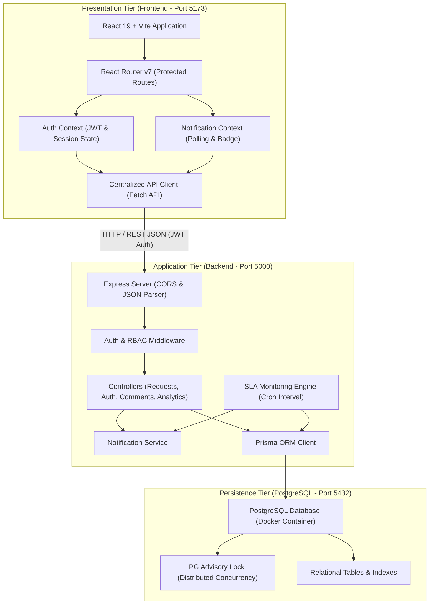
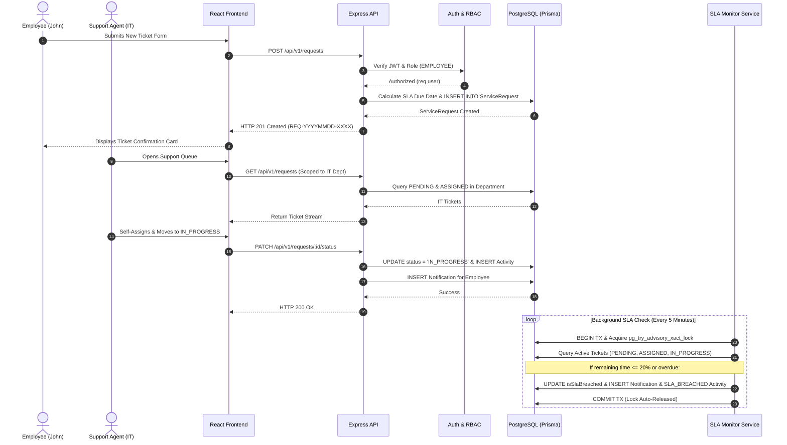

# System Architecture & Design

This document details the software architecture, design patterns, component interactions, and data flow of the **Employee Service Request System**.

---

## 1. High-Level Architecture Overview

The system follows a modern, decoupled client-server architecture utilizing **React + Vite** for the presentation layer and **Express.js + Prisma ORM + PostgreSQL** for the backend persistence and business logic layers.



---

## 2. Presentation Layer Architecture (Frontend)

The frontend is built using **React 19** and bundled with **Vite 8**. It adheres to a component-driven, modular structure:

### Key Components:
- **Routing & Guards ([`src/App.jsx`](file:///c:/Users/varun/OneDrive/Desktop/employee-service-request-system/frontend/src/App.jsx)):** Uses `react-router-dom` with a centralized [`ProtectedRoute`](file:///c:/Users/varun/OneDrive/Desktop/employee-service-request-system/frontend/src/components/common/ProtectedRoute.jsx) component that enforces both authentication status and role access matrices (`EMPLOYEE`, `SUPPORT_AGENT`, `ADMIN`).
- **State Management:**
  - [`AuthContext.jsx`](file:///c:/Users/varun/OneDrive/Desktop/employee-service-request-system/frontend/src/context/AuthContext.jsx): Manages authentication lifecycle, token storage in `localStorage`, user session caching, and automated revalidation via `/api/v1/auth/me`.
  - [`NotificationContext.jsx`](file:///c:/Users/varun/OneDrive/Desktop/employee-service-request-system/frontend/src/context/NotificationContext.jsx): Manages in-app alerts, unread counters, and background polling (every 30 seconds) strictly scoped to active sessions.
- **Centralized API Client ([`src/api/client.js`](file:///c:/Users/varun/OneDrive/Desktop/employee-service-request-system/frontend/src/api/client.js)):**
  - Injects `Authorization: Bearer <token>` into outgoing requests.
  - Intercepts HTTP 401 Unauthorized responses to dispatch an `auth:expired` event, cleanly resetting local session state.
- **Role-Based Dynamic Dashboards:**
  - [`EmployeeDashboard.jsx`](file:///c:/Users/varun/OneDrive/Desktop/employee-service-request-system/frontend/src/pages/dashboard/EmployeeDashboard.jsx): Personal metrics, recent submissions, and fast action triggers.
  - [`AgentDashboard.jsx`](file:///c:/Users/varun/OneDrive/Desktop/employee-service-request-system/frontend/src/pages/dashboard/AgentDashboard.jsx): Department triage queues, SLA alert notifications, and assigned ticket streams.
  - [`AdminDashboard.jsx`](file:///c:/Users/varun/OneDrive/Desktop/employee-service-request-system/frontend/src/pages/dashboard/AdminDashboard.jsx): Company-wide KPI metrics, SLA compliance rate (%), average resolution time, and lifecycle breakdowns.

---

## 3. Application Layer Architecture (Backend)

The backend is built with **Node.js** and **Express.js**, following clean layered separation:

```
backend/src/
├── config/       # Database & Prisma Client instances
├── controllers/  # Request handling, input validation, and HTTP responses
├── middlewares/  # JWT authentication, role guards (RBAC), and error handling
├── routes/       # Express route definitions grouped by domain
├── services/     # SLA Monitoring Engine, Notification dispatchers
└── utils/        # SLA calculation, status transitions, and token signing
```

### Layer Responsibilities:
1. **Route Layer:** Mounts REST resources (`/auth`, `/departments`, `/categories`, `/requests`, `/notifications`, `/analytics`) under `/api/v1`.
2. **Middleware Layer:**
   - [`authMiddleware.js`](file:///c:/Users/varun/OneDrive/Desktop/employee-service-request-system/backend/src/middlewares/authMiddleware.js): Verifies JWT signatures, extracts user ID and role, and loads active account status.
   - [`roleMiddleware.js`](file:///c:/Users/varun/OneDrive/Desktop/employee-service-request-system/backend/src/middlewares/roleMiddleware.js): Guarantees that only authorized roles execute specific endpoints.
3. **Controller Layer:** Implements business validation, error handling, and parameter parsing.
4. **Service Layer:**
   - [`slaMonitorService.js`](file:///c:/Users/varun/OneDrive/Desktop/employee-service-request-system/backend/src/services/slaMonitorService.js): Periodic background task scanning active tickets for 20% remaining-time warnings and overdue breaches.
   - [`notificationService.js`](file:///c:/Users/varun/OneDrive/Desktop/employee-service-request-system/backend/src/services/notificationService.js): Dispatches in-app notifications for ticket assignment, status progression, and discussion comments.

---

## 4. End-to-End Request Flow

The following sequence diagram illustrates a typical request lifecycle from ticket creation to triage and resolution:



---

## 5. Distributed Concurrency & Locking Architecture

To support multi-process and multi-container horizontal scaling, the SLA monitoring engine employs **PostgreSQL Transaction-Level Advisory Locks**:

```sql
SELECT pg_try_advisory_xact_lock(88442211) AS "hasLock";
```

### Architectural Guarantees:
- **Connection Affinity:** Enclosed entirely within a Prisma interactive transaction (`prisma.$transaction(async (tx) => { ... })`), pinning the lock to the exact connection checked out from the pool.
- **Mutual Exclusion:** Only one instance or process across the entire server cluster acquires the lock. Secondary processes immediately receive `{ hasLock: false }` and skip ticket evaluation without race conditions or duplicate notification dispatches.
- **Deterministic Cleanup:** PostgreSQL automatically releases transaction-level locks upon transaction completion (`COMMIT` or `ROLLBACK`). Even in the event of an unhandled exception or process termination, PostgreSQL frees the lock instantly with zero risk of connection pool leaks.
