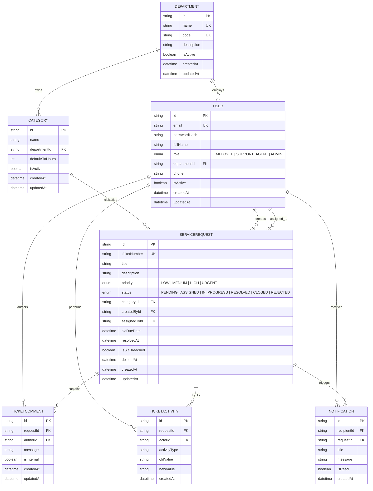

# Database Architecture & Data Dictionary

This document details the PostgreSQL database schema, Prisma ORM models, relations, indexing strategies, migrations, and development seeding for the **Employee Service Request System**.

---

## 1. Entity-Relationship Diagram (ERD)



---

## 2. Model Specifications & Schema Attributes

### 1. `User` Model
Stores system accounts across all three user roles:
- `id`: UUID Primary Key (`@default(uuid())`).
- `email`: Normalized lowercase unique email address (`@unique`).
- `passwordHash`: Bcrypt salted password hash (10 salt rounds).
- `role`: Enum `Role` (`EMPLOYEE`, `SUPPORT_AGENT`, `ADMIN`), defaults to `EMPLOYEE`.
- `departmentId`: Foreign key to `Department` (nullable for global Admins).
- `isActive`: Boolean flag (`@default(true)`). When set to `false`, access is blocked at login.

### 2. `Department` Model
Represents operational units (e.g., Information Technology, Human Resources, Facilities):
- `id`: UUID Primary Key.
- `name`: Full department title (e.g., "Information Technology") (`@unique`).
- `code`: Standard identifier code (e.g., "DEPT-IT") (`@unique`).
- `isActive`: Soft toggle allowing departments to be enabled/disabled.

### 3. `Category` Model
Defines service types within a department and sets baseline resolution targets:
- `id`: UUID Primary Key.
- `name`: Category name (e.g., "Hardware Issues", "Leave Inquiries").
- `departmentId`: Foreign key to `Department`.
- `defaultSlaHours`: Baseline resolution duration in hours (e.g., 24, 48).
- `isActive`: Flag indicating whether employees can select this category for new tickets.

### 4. `ServiceRequest` Model
Core ticket entity capturing status, SLA calculation, and assignments:
- `id`: UUID Primary Key.
- `ticketNumber`: Human-readable identifier format `REQ-YYYYMMDD-XXXX` (`@unique`).
- `priority`: Enum `Priority` (`LOW`, `MEDIUM`, `HIGH`, `URGENT`), defaults to `MEDIUM`.
- `status`: Enum `RequestStatus` (`PENDING`, `ASSIGNED`, `IN_PROGRESS`, `RESOLVED`, `CLOSED`, `REJECTED`).
- `slaDueDate`: Calculated deadline based on category base SLA hours and priority multiplier.
- `resolvedAt`: Timestamp recorded upon transitioning to `RESOLVED`.
- `isSlaBreached`: Flag set to `true` if resolution exceeds `slaDueDate`.
- `deletedAt`: Soft-deletion timestamp. When populated, tickets are hidden from normal queues.

### 5. `TicketComment` Model
Discussion records associated with a ticket:
- `message`: Text content of the comment or note.
- `isInternal`: Boolean flag (`@default(false)`). When `true`, the comment is an internal staff note and is strictly hidden from `EMPLOYEE` users.

### 6. `TicketActivity` Model
Immutable audit log recording all lifecycle actions:
- `activityType`: Action identifier (`REQUEST_CREATED`, `ASSIGNMENT`, `STATUS_CHANGE`, `PRIORITY_CHANGE`, `TICKET_REOPENED`, `SLA_BREACHED`, `COMMENT_ADDED`).
- `oldValue` / `newValue`: Audit state diff captured as string or serialized JSON.

### 7. `Notification` Model
In-app alerts dispatched to users:
- `recipientId`: Foreign key to the user receiving the notification.
- `requestId`: Foreign key linking to the relevant service request.
- `isRead`: Boolean flag (`@default(false)`).

---

## 3. Indexing & Performance Strategy

To ensure sub-millisecond query execution across large ticket volumes, composite indexes were engineered in [`prisma/schema.prisma`](file:///c:/Users/varun/OneDrive/Desktop/employee-service-request-system/backend/prisma/schema.prisma):

```prisma
@@index([createdById, deletedAt])
@@index([assignedToId, status, deletedAt])
@@index([categoryId, status, deletedAt])
@@index([slaDueDate, isSlaBreached, status])
@@index([status, deletedAt])
```

- **Employee Listing Index:** `[createdById, deletedAt]` enables $O(\log N)$ retrieval of personal tickets.
- **Agent Queue Index:** `[assignedToId, status, deletedAt]` optimizes queries for unassigned and assigned department queues.
- **SLA Engine Monitoring Index:** `[slaDueDate, isSlaBreached, status]` allows the background SLA engine to scan active, unbreached tickets without performing sequential table scans.

---

## 4. Migration & Seeding Procedures

### Prisma Migrations
Database schema changes are tracked via Prisma Migrate:

```powershell
cd backend
npx prisma migrate dev --name <migration_name>
```

### Idempotent Seed Script
The project includes an idempotent development seed script in [`backend/prisma/seed.js`](file:///c:/Users/varun/OneDrive/Desktop/employee-service-request-system/backend/prisma/seed.js). It creates departments, categories with SLA hours, demo accounts with bcrypt-hashed passwords, sample tickets, comments, and audit entries without creating duplicate records on repeated execution:

```powershell
cd backend
node prisma/seed.js
```
