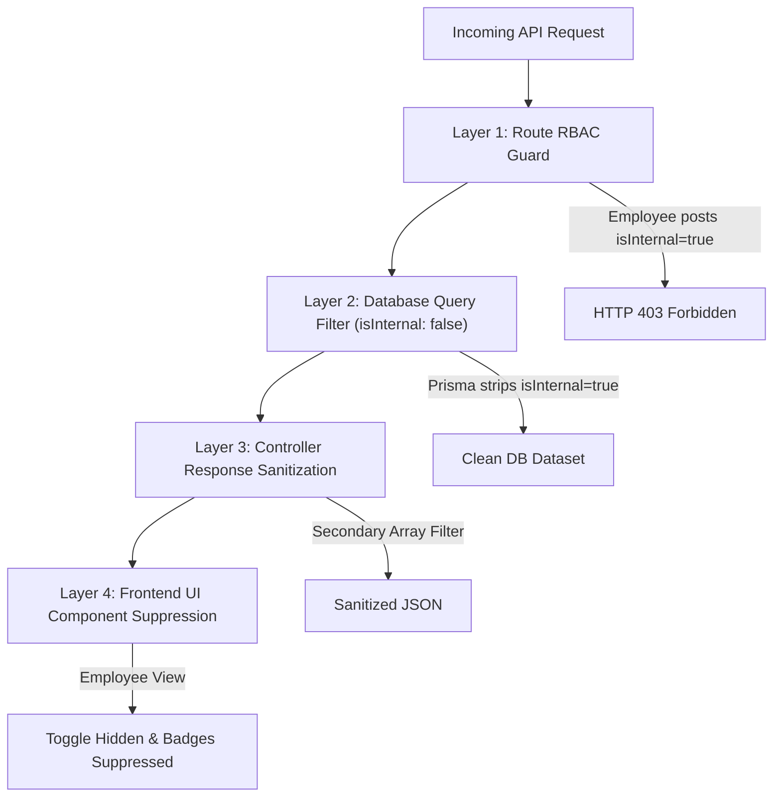

# Security Architecture & Access Control Policy

This document provides a comprehensive security review of the **Employee Service Request System**, covering authentication mechanisms, role-based authorization, multi-tenant scoping, internal note confidentiality, and vulnerability mitigations.

---

## 1. Authentication & Credential Security

### Password Hashing
- Passwords are never stored in plain text.
- Password hashing is enforced using `bcryptjs` with **10 salt rounds**, offering robust resistance against brute-force and rainbow table attacks.
- Minimum password length is enforced at 8 characters during registration.

### JWT Session Tokens
- Stateless session management is achieved using JSON Web Tokens (JWT) signed via `HMAC-SHA256`.
- JWT payloads contain only non-sensitive identifiers (`userId`, `role`, `departmentId`).
- Tokens expire automatically after 24 hours (`JWT_EXPIRES_IN="1d"`).
- Secrets are stored in server-side environment variables (`JWT_SECRET`) and are never exposed to client bundles or repository tracking.

### Account Lifecycle & Deactivation
- Deactivated users (`isActive: false`) are rejected at the login endpoint with HTTP 403 Forbidden, immediately terminating system access without issuing tokens.

---

## 2. Role-Based Access Control (RBAC) & Data Scoping

The system defines three distinct user roles:

| Capability / Route | Employee (`EMPLOYEE`) | Support Agent (`SUPPORT_AGENT`) | System Admin (`ADMIN`) |
| :--- | :---: | :---: | :---: |
| **Submit Requests** | ✓ Allowed | ✕ Denied | ✓ Allowed |
| **View Requests** | Own Created Only | Own Assigned + Dept Unassigned | Global Company-Wide |
| **Edit Pending Request** | Own Request Only | ✕ Denied | ✓ Allowed |
| **Assign Tickets** | ✕ Denied | Dept Scope (Self-Assign) | Global Assignment |
| **Status Progression** | ✕ Denied | Assigned / Dept Queue | Global |
| **Reopen Tickets** | Own Created (Resolved/Closed) | ✕ Denied | ✓ Allowed |
| **Internal Staff Notes** | ✕ Strictly Hidden | ✓ View & Create | ✓ View & Create |
| **Department / Category Config** | ✕ Denied | ✕ Denied | ✓ Create / Edit |
| **Trigger SLA Monitor** | ✕ Denied | ✕ Denied | ✓ Allowed |

---

## 3. Defense-in-Depth Confidentiality for Internal Notes

Internal staff notes are used by support teams to record diagnostic steps, server passwords, or internal triage decisions. The system applies **four distinct layers of defense** to ensure employees can never access internal notes:

1. **Route Guard:** `commentController.js` validates that any request setting `isInternal: true` must possess `SUPPORT_AGENT` or `ADMIN` role. Employees attempting to post internal notes are blocked with **HTTP 403 Forbidden**.
2. **Database Query Filtering:** `prisma.ticketComment.findMany` includes `where: { isInternal: false }` when `req.user.role === 'EMPLOYEE'`.
3. **Controller Sanitization:** `requestController.js` applies an explicit filter `request.comments = request.comments.filter(c => !c.isInternal)` before serializing the ticket details payload.
4. **UI Suppression:** The internal note checkbox and internal note cards are conditionally rendered only for agents and admins.

---

## 4. Multi-Tenant Scoping & Inter-Agent Isolation

- **Cross-Department Isolation:** Support Agents belonging to `DEPT-HR` receive **HTTP 403 Forbidden** when attempting to access, triage, or comment on `DEPT-IT` tickets.
- **Inter-Agent Isolation:** Support Agents can only access tickets assigned specifically to their own user ID, or unassigned tickets waiting in their department queue. An IT Agent is strictly blocked from viewing or modifying tickets assigned to another IT Agent.
- **Notification Ownership:** All notification operations (`GET /notifications`, `PATCH /notifications/:id/read`, `PATCH /notifications/read-all`) strictly filter by `recipientId: req.user.id`. Cross-user modifications are rejected with **HTTP 403 Forbidden**.

---

## 5. Known Security Limitations & Recommendations

1. **Rate Limiting:** In high-traffic production environments, rate limiting (e.g. `express-rate-limit` with Redis) should be introduced on `/api/v1/auth/login` to thwart distributed brute-force attempts.
2. **Refresh Token Rotation:** Replacing single 24-hour access tokens with short-lived access tokens (15 minutes) paired with rotating refresh tokens stored in `httpOnly` secure cookies will enhance session safety.
3. **Content Security Policy (CSP):** Implementing helmet HTTP security headers (`helmet`) will protect against XSS and clickjacking in multi-tenant browser environments.
